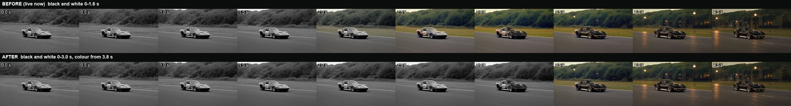

# Change 2026-11-10 · Homepage hero: black and white lasts longer

**Page:** homepage `/`, the hero film.
**What changes:** the opening of the hero film stays in black and white until 3.0 s, then turns to colour by 3.8 s.
Before this change it was black and white until 1.6 s.
Only the grade changes. The length (40.04 s), the frame rate (24 fps), the size, the poster and the 10 s point where the
second slide starts are all the same as before, so **no JavaScript or CSS changes**.



## 1. Replace two files

In the live theme, replace these with the files in `videos/`, keeping the same names:

| File | Size | Replaces on the server |
|---|---|---|
| `videos/hero-v3.mp4` | 1280×720 · 9.3 MB | `wp-content/themes/aanWordpress/videos/hero-v3.mp4` |
| `videos/hero-v3-mobile.mp4` | 720×406 · 2.7 MB | `wp-content/themes/aanWordpress/videos/hero-v3-mobile.mp4` |

## 2. Bust the cache (required)

The server sends these files with `Cache-Control: max-age=31536000`, so returning visitors would keep the old film for up
to a year. In the homepage hero `<video id="home-video">`, add `?v=2` to both sources:

```html
<source src="…/aanWordpress/videos/hero-v3-mobile.mp4?v=2" type="video/mp4" media="(max-width: 699px)" />
<source src="/wp-content/themes/aanWordpress/videos/hero-v3.mp4?v=2" type="video/mp4" />
```

If a CDN or page cache sits in front of WordPress, purge it for the homepage.

## 3. Check

- Open the homepage in a private window. The No. 48 race car is black and white for about 3 seconds, then the colour comes
  in as it turns into the black 441.
- On a phone (or below 700px), the same.
- The "The GT" / "Since 1923" controller still switches at 10 s.

Reference build: https://sigovs.github.io/LAKE-FOREST/handoff/site/index.html
