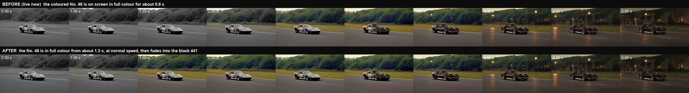
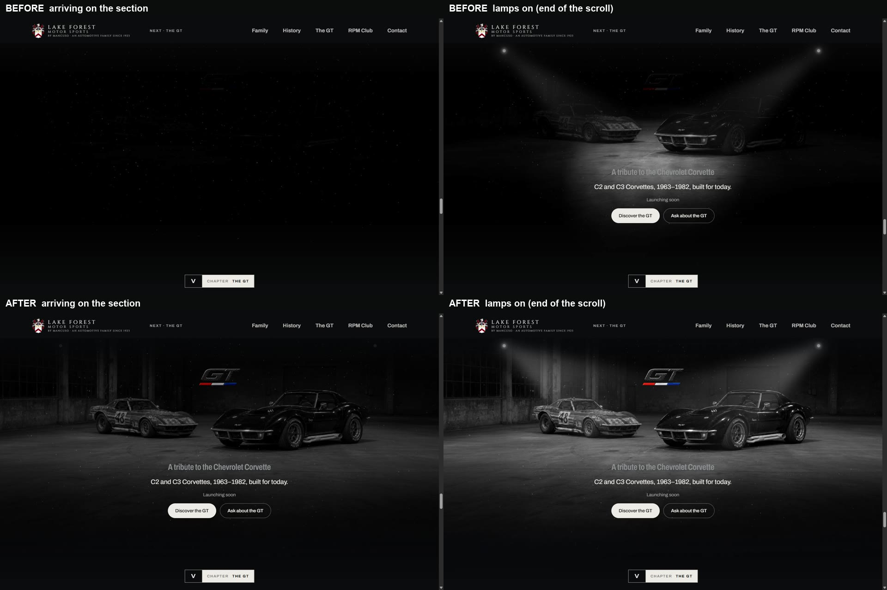
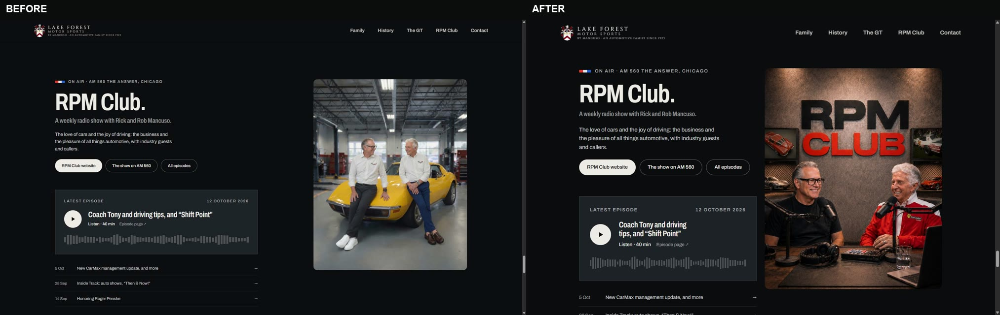

# Update 1 · changes to www.lakeforestmotorsports.com

**Status:** 2 and 3 approved by the client. 1 was revised on 11 November after the client's correction; 4 and 5 were added the same day. 1, 4 and 5 are in the client preview. Apply when all five are approved.
**Site:** www.lakeforestmotorsports.com, WordPress theme `wp-content/themes/aanWordpress/`.
**Reference build with every change applied:** https://sigovs.github.io/LAKE-FOREST/handoff/site/index.html
**This folder:** https://github.com/Sigovs/LAKE-FOREST/tree/main/handoff/changes/update-1

This file is written so it can be handed to an AI coding agent (Claude or similar) as is. Every change below gives the exact file,
the exact text before and after, the files to download, and how to check it. Before and after were checked against the live site
on 11 November 2026.

---

## Instructions for the agent

You are updating the WordPress theme `aanWordpress` of www.lakeforestmotorsports.com. Apply the five changes below, in order.

Rules:
- Change only what is listed. Do not reformat, rename or refactor anything else.
- `assets/css/style.css` may be minified. Match each rule by its selector and edit it in place, in the same style as the file.
- If a "before" text is not found exactly, stop and report it. Do not guess.
- Download the files from the URLs given. Do not re-encode, resize or rename them.
- When done, bump the version query of `assets/css/style.css` and `assets/js/aan-home.js` in the theme's enqueue, and purge any
  page cache or CDN.
- Report each change as done or not done, and the result of each check.

| # | Page | Change | Files touched |
|---|---|---|---|
| 1 | `/` | Hero film: the coloured No. 48 stays longer before it turns into the black 441 | `videos/hero-v3.mp4`, `videos/hero-v3-mobile.mp4`, the homepage hero `<video>` |
| 2 | `/` (desktop) | GT block: the words show at once, and the picture is lighter | `assets/js/aan-home.js`, `assets/css/style.css` |
| 3 | `/` and `/rpm/` | RPM Club: the studio picture replaces the yellow-Corvette photograph | `images/mockup/rpm-studio.jpg` (new), the RPM `` on both pages |
| 4 | `/rpm/` (desktop) | RPM Club page: the hosts' photograph lines up with "Where to listen" | `assets/css/style.css` (one rule added) |
| 5 | `/rpm/` and `/contact/` | The History page's background light on the RPM Club and Contact pages | `assets/css/style.css` (four rules added) |

---

## 1. Homepage hero film: the colour stays longer

The concept film opens with the No. 48 race car in black and white, colours it, and then turns it into the black 441 street car.
The client asked to hold the colour on the No. 48 longer before it fades into the new car. In the new film the No. 48 takes its
colour sooner, at about 1–1.4 s, so it is in full colour from about 1.3 s to about 2.6 s (it used to be about 0.6 s), and then turns
into the 441 exactly as before. The film plays at its own speed throughout: nothing is slowed down or sped up. The length (40.04 s),
the frame rate, the size, the poster and the 10 s point where the second slide starts are all as before, so **no code changes**.



**1a. Replace two files.** Download them and overwrite these files on the server, keeping the same names:

| Download | Size | Overwrite |
|---|---|---|
| https://raw.githubusercontent.com/Sigovs/LAKE-FOREST/main/handoff/changes/update-1/videos/hero-v3.mp4 | 1280×720 · 9,742,359 bytes | `wp-content/themes/aanWordpress/videos/hero-v3.mp4` |
| https://raw.githubusercontent.com/Sigovs/LAKE-FOREST/main/handoff/changes/update-1/videos/hero-v3-mobile.mp4 | 720×406 · 2,824,241 bytes | `wp-content/themes/aanWordpress/videos/hero-v3-mobile.mp4` |

**1b. Bust the cache (required).** The server sends these videos with `Cache-Control: max-age=31536000`, so without a new URL
returning visitors would keep the old film for up to a year. In the homepage hero `<video id="home-video">`, add `?v=2` to both sources.

Before:
```html
<source src="https://www.lakeforestmotorsports.com/wp-content/themes/aanWordpress/videos/hero-v3-mobile.mp4" type="video/mp4" media="(max-width: 699px)" />
<source src="/wp-content/themes/aanWordpress/videos/hero-v3.mp4" type="video/mp4" />
```
After:
```html
<source src="https://www.lakeforestmotorsports.com/wp-content/themes/aanWordpress/videos/hero-v3-mobile.mp4?v=2" type="video/mp4" media="(max-width: 699px)" />
<source src="/wp-content/themes/aanWordpress/videos/hero-v3.mp4?v=2" type="video/mp4" />
```

**Check:**
- `curl -sI <video URL>?v=2` returns `Content-Length: 9742359` (desktop) and `2824241` (mobile).
- In a private window: the No. 48 is black and white for about 1 s, in full colour from about 1.3 s to about 2.6 s, then turns
  into the black 441 by about 3.5 s, at normal speed. The same below 700px.
- The "The GT" / "Since 1923" controller still switches at 10 s.

---

## 2. Homepage GT block: words at once, a lighter picture

This is the "A tribute to the Chevrolet Corvette" block (`#gt`), on desktop only. On a phone (below 700px) it is a still picture and
does not change.

- **The words are there on arrival.** "A tribute to the Chevrolet Corvette", the lead line, "Launching soon" and the two buttons used
  to fade in near the end of the pinned scroll. Now they are visible from the start.
- **The picture is lighter.** The two cars and the GT mark are visible from the start. The two lamps still strike on the scroll and
  add their pools of light. The beams, the pointer torch and the dust are unchanged.
- The pin, its length and the lamp timing are unchanged.



**2a. JavaScript: `assets/js/aan-home.js`, the GT timeline (lines 368–369 on 11 Nov 2026).**

Replace this line:
```js
      .fromTo(q('.gt__dark'), { filter: 'brightness(0.16) contrast(1.05)' }, { filter: 'brightness(0.3) contrast(1.05)', duration: 0.5 }, 0.38)
```
with:
```js
      .fromTo(q('.gt__dark'), { filter: 'brightness(1) contrast(1.05)' }, { filter: 'brightness(1.05) contrast(1.05)', duration: 0.5 }, 0.38)
```

Delete this line completely:
```js
      .fromTo(qa('.gt__top > *, .gt__bottom > *'), { autoAlpha: 0, y: 12 }, { autoAlpha: 1, y: 0, duration: 0.3, stagger: 0.04, ease: 'power1.out' }, 0.72)
```
Keep the rest of the timeline as it is, including the line that follows, `.to({}, { duration: 0.2 }, 1.2)`. Check that the
chain still ends with a semicolon.

**2b. CSS: `assets/css/style.css`.** Change three rules. Here they are as they appear in the live (minified) file.

| Before | After |
|---|---|
| `.gt__dark{filter:brightness(0.16) contrast(1.05)}` | `.gt__dark{filter:brightness(1) contrast(1.05)}` |
| `.gt__stage--photo .gt__dark img{filter:brightness(0.55)}` | `.gt__stage--photo .gt__dark img{filter:brightness(0.72)}` |
| `.gt__stage--photo .gt__lit img{filter:brightness(0.68) contrast(1.08)}` | `.gt__stage--photo .gt__lit img:not(.gt__mark){filter:brightness(1.2) contrast(1.08)}` |

The `:not(.gt__mark)` in the third rule matters. The old rule also dimmed the GT logo above the cars, which is why it looked grey.
The logo keeps its own rule, which is already in the file and must not change: `.gt__stage--photo .gt__mark--cs{…filter:drop-shadow(…)…}`.

**Check, on a desktop at 1440 or 1920 wide:**
- On reaching the block, the cars, the GT logo and all the words are visible, and the two lamps are still dark.
- Scrolling on, the left lamp strikes, then the right one, and the cars brighten in their pools. Then the block releases.
- With the mouse over the block, the torch and the lamps still follow it.
- The console shows no errors. Below 700px, nothing changes.

---

## 3. RPM Club: the studio picture replaces the yellow-Corvette photograph

The client does not want the photograph of Rob and Rick on the yellow Corvette. It is replaced by the studio picture from the
show's own website (rpmclub.com): both hosts at their microphones under the RPM Club sign. This applies to the homepage RPM Club
block and the RPM Club page hero. The layout does not change, only the image.



**3a. Add one file.** Download it and save it as `wp-content/themes/aanWordpress/images/mockup/rpm-studio.jpg`:

| Download | Size |
|---|---|
| https://raw.githubusercontent.com/Sigovs/LAKE-FOREST/main/handoff/changes/update-1/images/rpm-studio.jpg | 576×1024 · 170,955 bytes (the show's own `rpm-studio-mobile.jpg`) |

**3b. Homepage `/`, the RPM Club block (`<figure class="rpm__photo">`).** Replace the ``.

Before:
```html
    
```
After:
```html
    
```

**3c. RPM Club page `/rpm/`, the hero picture (`<figure class="cp-hero__pic">`).** Replace the ``, and keep its
`<figcaption>` ("Rob and Rick Mancuso, the hosts.").

Before:
```html

```
After:
```html

```

No CSS changes: both slots already crop to a portrait frame (`object-fit: cover`), and the `object-position` keeps the sign and
both hosts in it. Once both pages are updated, `rpm-yellow-vette.jpg` is no longer used.

**Check:** on `/` and on `/rpm/`, at desktop and on a phone, the RPM CLUB sign and both hosts are in the frame, with nothing cut off.

---

## 4. RPM Club page: the hosts' photograph lines up with "Where to listen"

On `/rpm/`, desktop only (1000px and wider). The photograph in the hero (`<figure class="cp-hero__pic">`) sat against the
right edge of its column at no more than 420px, so on wide screens its left edge stood well to the right of the
"Where to listen" block below it (about 170px at 1920). Now it starts on the same line as "Where to listen" and fills
the same column, never wider than the file itself (576px). Below 1000px nothing changes.

**4a. CSS: `assets/css/style.css`.** Add this rule at the very end of the file. Change nothing else; the existing
`.cp-hero__pic` rules stay as they are.

```css
@media (min-width:1000px){.rpage .cp-hero__pic{justify-self:start;width:min(100%,576px)}}
```

**Check, on `/rpm/` at 1440 and 1920 wide:**
- The left edge of the photograph and the left edge of "Where to listen" are on one vertical line.
- The photograph is whole, with its caption "Rob and Rick Mancuso, the hosts." under it.
- Below 1000px the page looks as before.
- The homepage RPM Club block is not affected (the rule only applies on the RPM page, `body.rpage`).

---

## 5. RPM Club and Contact: the History page's background

The History page (`/history/`) has a background of its own: one fixed layer of grey, uneven light with a fine grain,
behind the whole page, which the content scrolls over (the `.hist::before` / `.hist::after` rules in `style.css`).
The same layer now goes on the RPM Club page and the Contact page, with the same values. Nothing else on those
pages changes.

**5a. CSS: `assets/css/style.css`.** Add these four rules at the very end of the file (after the rule from change 4).
They copy the live `.hist` rules exactly and put them on the two pages' WordPress template classes, which WordPress
already adds to `<body>` (`page-template-template-rpm`, `page-template-template-contact`). Do not change the `.hist` rules.

```css
.page-template-template-rpm,.page-template-template-contact{--grain: url("data:image/svg+xml,%3Csvg xmlns='http://www.w3.org/2000/svg' width='220' height='220'%3E%3Cfilter id='n'%3E%3CfeTurbulence type='fractalNoise' baseFrequency='.9' numOctaves='2' stitchTiles='stitch'/%3E%3CfeColorMatrix values='0 0 0 0 0 0 0 0 0 0 0 0 0 0 0 0 0 0 1.6 -.35'/%3E%3C/filter%3E%3Crect width='220' height='220' filter='url(%23n)'/%3E%3C/svg%3E");background:#0b0c0d;isolation:isolate}
.page-template-template-rpm::before,.page-template-template-rpm::after,.page-template-template-contact::before,.page-template-template-contact::after{content:"";position:fixed;z-index:-1;pointer-events:none;-webkit-mask-image:var(--grain);mask-image:var(--grain);-webkit-mask-size:220px 220px;mask-size:220px 220px}
.page-template-template-rpm::before,.page-template-template-contact::before{left:-14%;top:8%;width:104%;height:120vh;transform:rotate(-6deg);opacity:.62;background:url("/wp-content/themes/aanWordpress/images/mockup/rpm-glow.svg") center/100% 100% no-repeat}
.page-template-template-rpm::after,.page-template-template-contact::after{content:"";position:fixed;z-index:-1;pointer-events:none;-webkit-mask-image:var(--grain);mask-image:var(--grain);-webkit-mask-size:220px 220px;mask-size:220px 220px}
```

If the theme's page templates have other names, use the `page-template-…` classes that WordPress prints on the
`<body>` of `/rpm/` and `/contact/`. The image is the one History already uses:
`/wp-content/themes/aanWordpress/images/mockup/rpm-glow.svg`.

**Check, on `/rpm/` and `/contact/`, desktop and phone:**
- Behind the page there is the same soft, grainy light as on `/history/`, and it stays in place while the page scrolls.
- Text, buttons, the episode player, the form and the map look exactly as before (the map band stays dark).
- No horizontal scroll appears. The console shows no errors.
- `/history/` and the homepage look as before.
