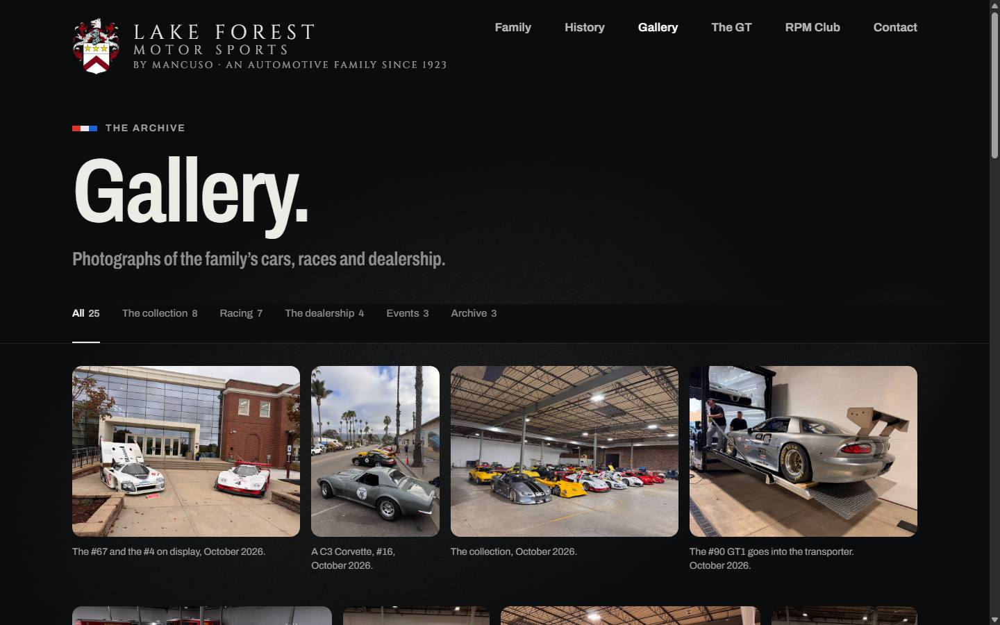
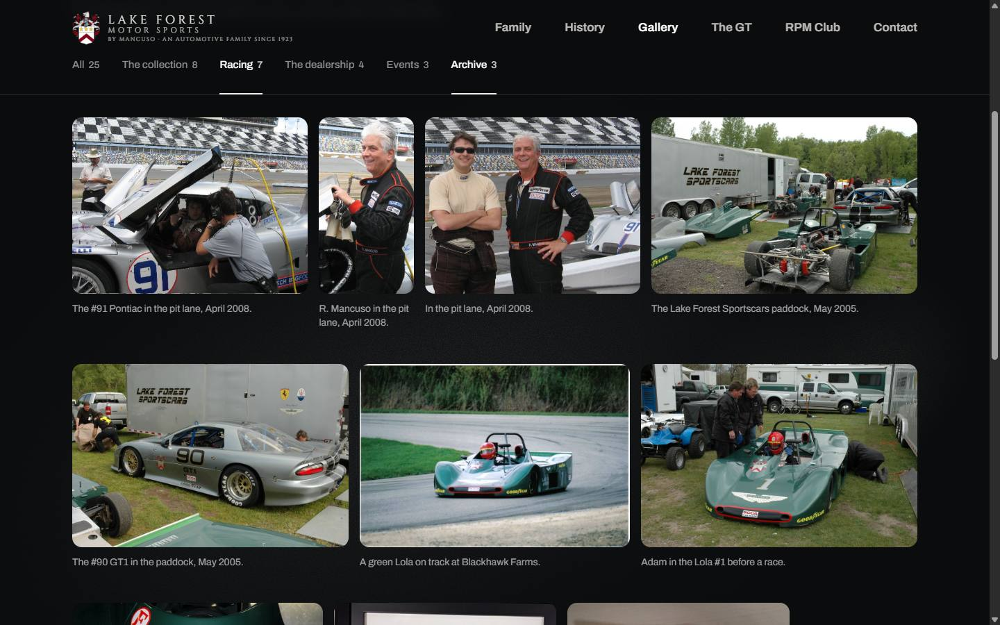
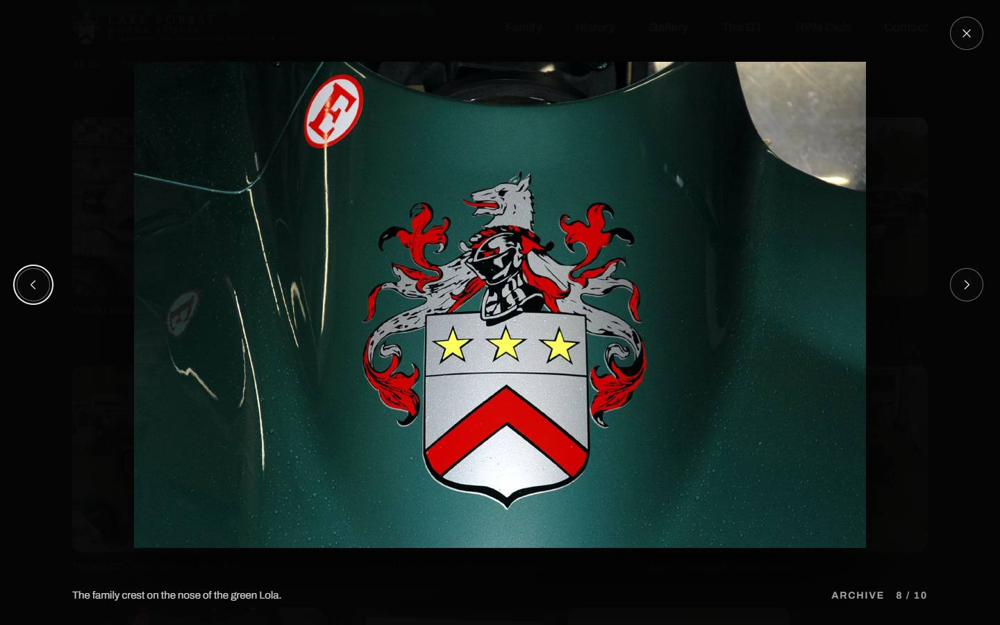
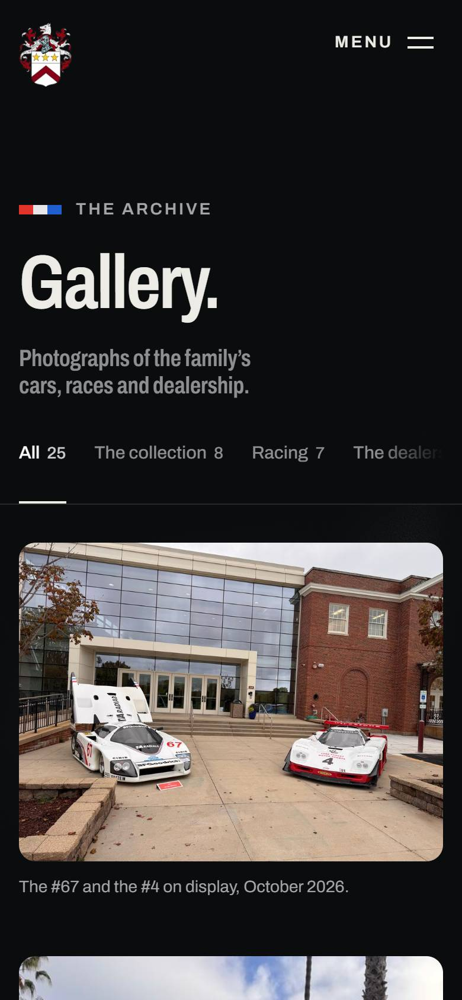

# Update 2 · the Gallery page on www.lakeforestmotorsports.com

**Status:** final (11 November 2026). The client wants it after update 1: apply update 1 first.
**Site:** www.lakeforestmotorsports.com, WordPress theme `wp-content/themes/aanWordpress/`.
**Reference build:** https://sigovs.github.io/LAKE-FOREST/handoff/site/gallery.html (the page as it must look and behave)
**This folder:** https://github.com/Sigovs/LAKE-FOREST/tree/main/handoff/changes/update-2

A new page, **Gallery**: the family's photo archive, which the client will fill and edit themselves in wp-admin. It is a
top-level item in the header menu, after History. It starts with 25 photographs, which are in this folder, ready to
import.

This file is written so it can be handed to an AI coding agent (Claude or similar) as is. Update 1 is independent of it
and can be applied before or after.



---

## Instructions for the agent

You are adding a page to the WordPress theme `aanWordpress` of www.lakeforestmotorsports.com. Apply the steps below, in order.

Rules:
- Add only what is listed. Do not reformat, rename or refactor anything else in the theme.
- Theme-specific structure (how a page template opens and closes, wrappers, `get_header()` / `get_footer()`) follows
  the existing `template-rpm.php`. If `template-gallery.php` below differs from that pattern, adapt the wrapper, not the
  markup inside `<main>`.
- Download the files from the URLs given. Do not re-encode, resize or rename the photographs.
- If a "before" text is not found exactly, stop and report it. Do not guess.
- Bump the version query of `assets/css/style.css` in the theme's enqueue, and purge any page cache or CDN when done.
- Report each step as done or not done, and the result of each check.

| # | What | Where |
|---|---|---|
| 1 | Add the theme files | `inc/gallery.php`, `template-gallery.php`, `assets/css/aan-gallery.css`, `assets/js/aan-gallery.js`, `assets/js/vendor/Flip.min.js`, one line in `functions.php` |
| 2 | Create the page | wp-admin → Pages: "Gallery", slug `gallery`, template "Gallery" |
| 3 | Import the first 25 photographs | WP-CLI, one command (or by hand) |
| 4 | Header: Gallery after History | wp-admin → Appearance → Menus, and one rule in `style.css` |
| 5 | Footer: Gallery after History | the footer template |
| 6 | History page: a link to the gallery at its end | the History page template, and one rule in `style.css` |

---

## 1. Add the theme files

Download each file and save it at the path given, inside `wp-content/themes/aanWordpress/`:

| Download | Save as |
|---|---|
| https://raw.githubusercontent.com/Sigovs/LAKE-FOREST/main/handoff/changes/update-2/theme/inc/gallery.php | `inc/gallery.php` |
| https://raw.githubusercontent.com/Sigovs/LAKE-FOREST/main/handoff/changes/update-2/theme/template-gallery.php | `template-gallery.php` |
| https://raw.githubusercontent.com/Sigovs/LAKE-FOREST/main/handoff/changes/update-2/theme/assets/css/aan-gallery.css | `assets/css/aan-gallery.css` |
| https://raw.githubusercontent.com/Sigovs/LAKE-FOREST/main/handoff/changes/update-2/theme/assets/js/aan-gallery.js | `assets/js/aan-gallery.js` |
| https://raw.githubusercontent.com/Sigovs/LAKE-FOREST/main/handoff/changes/update-2/theme/assets/js/vendor/Flip.min.js | `assets/js/vendor/Flip.min.js` |

Then add this line to `functions.php`, after the theme's other `require` / `include` lines:

```php
require_once get_template_directory() . '/inc/gallery.php';
```

What these do:
- `inc/gallery.php`:
  - registers the **Gallery** section in wp-admin (post type `lfms_photo`) and its **Categories** (taxonomy `lfms_photo_category`);
  - adds two image sizes, `lfms-gallery-tile` (960×720) and `lfms-gallery-full` (1600×1600), never cropped;
  - adds the body classes `cpage gpage` on the Gallery template, the same pattern as RPM Club's `cpage rpage`;
  - loads the page's CSS and JS on that template only.
- `template-gallery.php`: the page. Its markup inside `<main>` is the reference build's, one to one. The photographs and
  categories come from wp-admin. Only categories that hold a published photograph are shown, the fullest first.
- `aan-gallery.css`:
  - The page's styles.
  - The design tokens: on the live theme these are declared only on the homepage wrapper `.lf-home`, so this file
    declares the same set on `.gpage`, copied verbatim.
  - A reset of Bootstrap's margins, as the RPM Club template has.
  - The History page's background light.
- `aan-gallery.js`:
  - The category filter: several categories at once; a change re-lays the grid with GSAP Flip.
  - The photo viewer: arrows, swipe and Esc, with a link per photo (`#photo-<slug>`).
  - It loads after the theme's vendored `assets/js/vendor/gsap.min.js` (3.15.0) and `Flip.min.js` (the matching GSAP
    3.15.0 plugin). Without them the page still works, with no motion.

**Check:** wp-admin shows a **Gallery** menu item with "All photos", "Add photo" and "Categories". No PHP notices.

## 2. Create the page

wp-admin → Pages → Add New. Title **Gallery**, slug `gallery`, Page Attributes → Template: **Gallery**. Leave the content
empty and publish. The address is `https://www.lakeforestmotorsports.com/gallery/`.

## 3. Import the first 25 photographs

The photographs in `import/photos/` are web-ready: no EXIF or GPS, sRGB, at most 1600 px. `import/photos.json` lists each
one's caption, alternative text and category, newest first. Download the folder
(https://github.com/Sigovs/LAKE-FOREST/tree/main/handoff/changes/update-2/import) to the server and run:

```bash
wp eval-file import-gallery.php /path/to/import
```

It creates the five categories (The collection, Racing, The dealership, Events, Archive) and one Gallery photo per entry:
- the caption as its title;
- the file as its photograph, with its alternative text;
- its category;
- publish dates one minute apart, so the page keeps the list's order.

It is safe to run twice; existing entries are skipped. Without WP-CLI, the same can be done by hand in wp-admin from
`photos.json`.

**Check:** wp-admin → Gallery shows 25 photos with thumbnails, and `/gallery/` shows them, the first being "The #67 and the #4
on display, October 2026." The category bar reads: All 25 · The collection 8 · Racing 7 · The dealership 4 · Events 3 · Archive 3.

## 4. Header: Gallery after History

wp-admin → Appearance → Menus → the header menu (`menu-header-menu`): add the **Gallery** page and drag it between
**History** and **The GT**. Save. The header then reads: Family · History · **Gallery** · The GT · RPM Club · Contact.

With six items, between 992 and 1439 px wide, the line under the logo ("By Mancuso · An automotive family since 1923")
runs under the first links. Hide it in that range. The same line stays in the footer. Add this rule at the very end of
`assets/css/style.css`:

```css
@media (min-width:992px) and (max-width:1439px){.brand__by{display:none}}
```

**Check:** at 1024, 1280 and 1440 px the six links sit on one line, clear of the logo. Below 992 px the mobile menu lists
Gallery after History.

## 5. Footer: Gallery after History

In the footer template (the one that prints `<nav class="foot__nav" aria-label="Footer">`):

Before:
```html
<a href="https://www.lakeforestmotorsports.com/history/">History</a><a href="https://www.lakeforestmotorsports.com/gt/">The GT</a>
```
After:
```html
<a href="https://www.lakeforestmotorsports.com/history/">History</a><a href="https://www.lakeforestmotorsports.com/gallery/">Gallery</a><a href="https://www.lakeforestmotorsports.com/gt/">The GT</a>
```
If the template builds these links with `home_url()` or a menu, add Gallery the same way, after History.

## 6. History page: a link to the gallery at its end

In the History page template, add this block directly before `<section class="next" aria-labelledby="tnext">`
(the "Next · The GT" block at the end of the page):

```html
    <section class="next next--gallery" aria-labelledby="tgallery">
      <p class="chap__when">The archive</p>
      <h2 class="chap__title" id="tgallery">The gallery</h2>
      <div class="chap__text"><p>Photographs of the family’s cars, races and dealership, from 1976 to today.</p></div>
      <p class="pills"><a class="pill pill--line" href="https://www.lakeforestmotorsports.com/gallery/">Open the gallery</a></p>
    </section>
```

And this rule at the very end of `assets/css/style.css` (after the one from step 4):

```css
.next--gallery{padding-bottom:0}
```

**Check:** at the end of `/history/`, "The archive · The gallery" with an "Open the gallery" button sits just above "Next · The GT".

---

## Checks for the whole page, `/gallery/`

Compare with the reference build at 1440 and 390 px wide:



- **Layout:** the title, then a small category bar, then the photographs in rows of equal height, each photograph whole
  (no crop) with its caption under it. On a phone, one photograph per row. No horizontal scroll at any width.
- **Category bar:** stays under the header while scrolling.
  - Several categories can be chosen at once, each underlined; "All" resets.
  - When categories no longer fit, the bar scrolls sideways inside itself.
  - Choosing a category further down the page brings the grid back to just under the bar.
- **Viewer:** clicking a photograph opens it large, with its caption, category and "n / total". It never shows the
  photograph larger than its file.
  - Arrows, the keyboard arrows and a swipe step through the photos; Esc closes.
  - The address gets `#photo-<slug>`, so a photograph can be linked to directly.



- **Background:** the same grainy light as `/history/`.
- **Reduced motion** (the operating system setting): filtering and the viewer change instantly, with no animation.
- **Console:** no errors.



These steps were tried on the live site before this file was written. The page's markup, `aan-gallery.css`,
`aan-gallery.js`, GSAP and Flip were injected into a live page in a browser, with no change on the server. Layout, the
sticky bar under the theme's header (80 px desktop, 72 px phone), multi-select filtering, the scroll back to the grid,
the viewer and the six-item header were checked at 1440 and 390 px.

---

## For the client: how to add a photograph

wp-admin → **Gallery → Add photo**:
1. **Caption:** what is in the photograph, and when (e.g. "The #90 GT1 in the paddock, May 2005.").
2. **Photograph** (right column, "Set photograph"): upload it. Fill in its **Alternative Text**, a one-line description
   for screen readers.
3. **Categories** (right column): tick one or more. New categories can be added there or under Gallery → Categories.
4. **Publish.** Newest photographs appear first. To move one, change its publish date.

The page shows WordPress's resized copies only. They are saved without the phone's location data, so the original
upload's GPS position never appears on the site.
